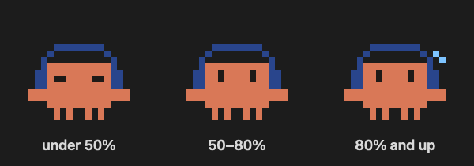
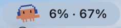
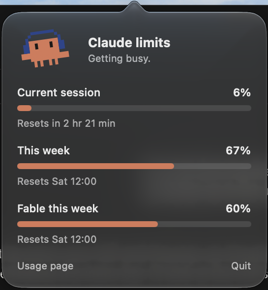

# Claude Limits: Claude usage limits in your Mac menu bar

**Claude Limits is a free, open-source macOS menu bar app that shows how much of your Claude usage limit you have left.** It tracks your 5-hour session limit, your weekly limit and per-model weekly limits (such as Fable), with the exact time each one resets. A dancing pixel Claude sits in your menu bar and speeds up as you get closer to a limit.

<p align="center">
  
</p>

## Features

- **Claude usage at a glance.** The menu bar shows your current session and weekly usage, for example `6% · 67%`.
- **Every limit on your plan.** Click the crab for a glass pop-up with the 5-hour session limit, the weekly limit and each per-model weekly limit.
- **Reset times.** See when your Claude limit resets: "Resets in 2 hr 21 min" or "Resets Sat 12:00".
- **Dances while Claude works.** The pixel Claude dances whenever Claude is generating a reply anywhere on your Mac: the Claude desktop app, Claude Code, Claude Design or claude.ai in any browser. When Claude finishes, it stands still, blinks now and then, and waits for you.
- **A mascot with moods.** It dances slowly while you have plenty of usage left, faster from 50%, and frantically with a sweat drop above 80%.
- **Covers Claude Code too.** Your plan limits are shared across claude.ai, the Claude desktop app and Claude Code, so the numbers include all of them.
- **Light and private.** One small Swift file, no Dock icon, no analytics. It only talks to claude.ai.

<p align="center">
  <br><br>
  
</p>

## Install

Requires macOS 14 Sonoma or later and the Xcode Command Line Tools (`xcode-select --install`).

```bash
git clone https://github.com/angelwingsy/claude-limits.git
cd claude-limits
./build.sh
open ~/Applications/"Claude Limits.app"
```

Click the crab, choose **Sign in**, and log in to claude.ai in the window that opens. The login is remembered between launches.

To start Claude Limits automatically, add it in **System Settings → General → Login Items**.

## FAQ

### How do I check my Claude usage limit on a Mac?

Install Claude Limits and look at the menu bar: the first number is your 5-hour session usage and the second is your weekly usage. Click it for every limit and its reset time. The same figures appear on the claude.ai usage page (Settings → Usage).

### When does my Claude usage limit reset?

The session limit resets 5 hours after your session starts. The weekly limits reset at a fixed time each week. Claude Limits shows both reset times in the pop-up.

### Does it work with Claude Code?

Yes. When you sign in to Claude Code with your Claude account, it uses the same plan limits as claude.ai, and Claude Limits shows the combined usage.

### Which Claude plans does it support?

Any claude.ai plan that has usage limits, including Pro, Max and Team. If your account belongs to several organizations, it reads the one you last used on claude.ai.

### Is it safe? Where does my data go?

Your login stays in the app's own web view on your Mac. The app reads the same usage data the claude.ai usage page shows and sends nothing anywhere else. All the code is in [`main.swift`](main.swift), so you can read it before building.

### Why does the crab dance when I'm not using Claude?

Anything that downloads from claude.ai counts, such as opening a claude.ai page or a Claude Code session loading. The dance stops a few seconds later. If you sit behind a corporate proxy, all traffic goes to the proxy, and the crab cannot tell Claude apart from other traffic.

### The numbers disappeared. What now?

Click the crab and choose **Usage page** to check you are still signed in. The app reads claude.ai's internal API, which is undocumented and can change. Errors are logged to `~/Library/Logs/ClaudeLimits.log`; please open an issue if it breaks.

## How it works

A hidden WebKit view keeps you signed in to claude.ai and fetches your organization's usage data every 5 minutes, after each page load and whenever you open the pop-up. The menu bar item and pop-up are built with AppKit and SwiftUI; the mascot is drawn pixel by pixel in code.

To know when Claude is working, the app keeps macOS's built-in `nettop` running and reads, once a second, how many bytes each connection to Anthropic's servers received, over TCP and over UDP (the desktop app and Claude Design use HTTP/3). A streaming reply feeds one connection every second, while idle traffic (heartbeats, polling) arrives in single blips. So the crab dances when any connection is busy in 3 of the last 4 seconds, and keeps dancing for 10 seconds to ride out pauses such as tool runs. While Claude thinks, the server sends a small keep-alive every second, which keeps the dance going too. The app reads byte counts only, never the content, and needs no extra permissions.

The rule's numbers are constants at the top of `ActivityMonitor` in `main.swift`. To see every sample, launch the app with `open ~/Applications/"Claude Limits.app" --args --debug` and watch `~/Library/Logs/ClaudeLimits.log`.

| File | What it does |
| --- | --- |
| `main.swift` | The whole app: menu bar item, pop-up, pixel mascot and data fetching |
| `build.sh` | Compiles it into `~/Applications/Claude Limits.app` |

## Contributing

Issues and pull requests are welcome, especially new mascot moods and dance moves.

## Disclaimer

Claude Limits is an unofficial fan project and is not affiliated with or endorsed by Anthropic. Claude is a trademark of Anthropic.

## License

[MIT](LICENSE)
